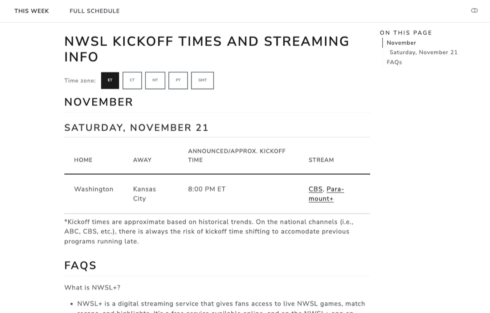
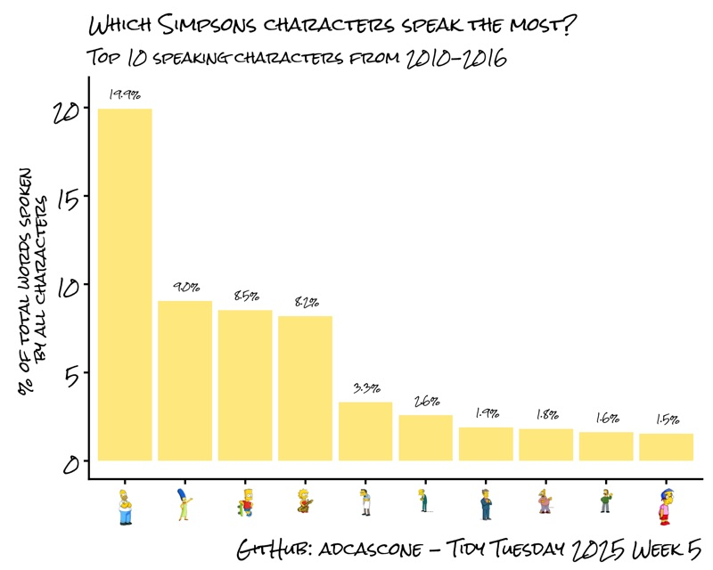

::: {.column-page}

```{=html}
<article class="ac-project-featured" aria-labelledby="proj-nwsl">
  <a class="ac-project-shot" href="https://nationalwomenssoccerleague.com/" target="_blank" rel="noopener noreferrer" tabindex="-1" aria-hidden="true">
    
  </a>
  <div class="ac-project-body">
    <p class="ac-kicker">Side project · 2026</p>
    <h2 id="proj-nwsl">NWSL Kickoffs</h2>
    <p>A fan site with every NWSL match's kickoff time and where to stream it, with a time-zone toggle and a team filter for the full season.</p>
    <p>It runs itself: each week a Python script pulls the latest schedule from ESPN, estimates real kickoff times from past broadcast patterns, and rebuilds the site, which GitHub Actions publishes automatically.</p>
    <p class="ac-project-built">Built with Python, Quarto, and GitHub Actions</p>
    <div class="ac-card-links">
      <a href="https://nationalwomenssoccerleague.com/" target="_blank" rel="noopener noreferrer">nationalwomenssoccerleague.com <i class="bi bi-arrow-up-right" aria-hidden="true"></i></a>
      <a href="https://github.com/adcascone/NWSL-kickoffs" target="_blank" rel="noopener noreferrer">Code on GitHub <i class="bi bi-arrow-up-right" aria-hidden="true"></i></a>
    </div>
  </div>
</article>

<div class="ac-cards ac-cards-3">
  <article class="ac-card">
    <div class="ac-card-icon" aria-hidden="true"><i class="bi bi-box-seam"></i></div>
    <p class="ac-kicker">Core developer · 2025–present</p>
    <h3>{admiral}</h3>
    <p>The pharmaverse R package for building CDISC ADaM datasets, the analysis datasets behind clinical trial submissions. As part of the core team I contribute documentation improvements and ADaM IG alignment work.</p>
    <div class="ac-card-links">
      <a href="https://pharmaverse.github.io/admiral/" target="_blank" rel="noopener noreferrer">Docs <i class="bi bi-arrow-up-right" aria-hidden="true"></i></a>
      <a href="https://github.com/pharmaverse/admiral" target="_blank" rel="noopener noreferrer">GitHub <i class="bi bi-arrow-up-right" aria-hidden="true"></i></a>
    </div>
  </article>

  <article class="ac-card">
    <div class="ac-card-icon" aria-hidden="true"><i class="bi bi-percent"></i></div>
    <p class="ac-kicker">Maintainer · 2026–present</p>
    <h3>{binom}</h3>
    <p>A CRAN package for binomial confidence intervals under several parameterizations. I took over as maintainer in 2026 and released version 1.1-2.</p>
    <div class="ac-card-links">
      <a href="https://github.com/adcascone/binom" target="_blank" rel="noopener noreferrer">GitHub <i class="bi bi-arrow-up-right" aria-hidden="true"></i></a>
      <a href="https://CRAN.R-project.org/package=binom" target="_blank" rel="noopener noreferrer">CRAN <i class="bi bi-arrow-up-right" aria-hidden="true"></i></a>
    </div>
  </article>

  <article class="ac-card">
    <div class="ac-card-thumb" aria-hidden="true">
      
    </div>
    <p class="ac-kicker">Data viz · 2025</p>
    <h3>Tidy Tuesday</h3>
    <p>Weekly data challenges from the R community, including my first Shiny app (on U.S. water insecurity) and a chart of which Simpsons characters talk the most.</p>
    <div class="ac-card-links">
      <a href="https://github.com/adcascone/tidy-tuesday-2025" target="_blank" rel="noopener noreferrer">Code <i class="bi bi-arrow-up-right" aria-hidden="true"></i></a>
      <a href="https://youtu.be/VNVL7yDO7uk" target="_blank" rel="noopener noreferrer">App demo <i class="bi bi-arrow-up-right" aria-hidden="true"></i></a>
    </div>
  </article>
</div>
```

:::
